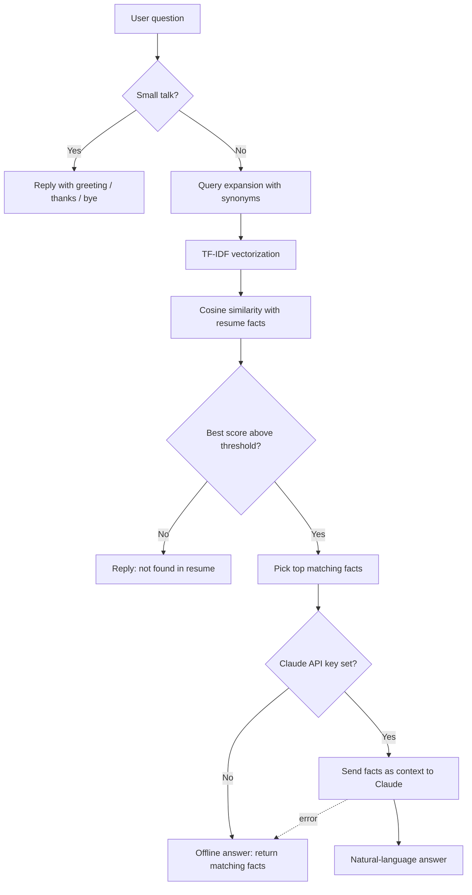

# 🤖 Resume Chatbot

An AI-powered chatbot written in **Python** that answers questions about a person's resume: skills, projects, education, experience and contact details. It runs **fully offline** (no API key needed) and can optionally use the **Claude API** for more natural, conversational answers.

Built with **Streamlit** (web UI) and **scikit-learn** (TF-IDF + cosine similarity).

---

## 📌 Table of Contents
- [Overview](#-overview)
- [Features](#-features)
- [Tech Stack](#-tech-stack)
- [How It Works](#-how-it-works)
- [AI Concepts Used](#-ai-concepts-used)
- [Project Structure](#-project-structure)
- [Installation](#-installation)
- [Usage](#-usage)
- [Customize With Your Own Data](#-customize-with-your-own-data)
- [Claude Mode (Optional)](#-claude-mode-optional)
- [Deployment](#-deployment)
- [Sample Conversation](#-sample-conversation)
- [Troubleshooting](#-troubleshooting)
- [Future Improvements](#-future-improvements)
- [Author](#-author)

---

## 🔍 Overview

Recruiters and visitors often want quick answers about a candidate without reading a full CV. This chatbot lets them simply **ask questions** such as *"What are his skills?"* or *"Tell me about his final year project"* and get an instant, accurate reply based only on the resume data.

If a question is not covered by the resume, the bot says so instead of making something up.

---

## ✨ Features

- 💬 Chat interface (browser) and terminal mode
- 🧠 Understands different wordings of the same question (query expansion)
- 🎯 Answers only from resume data (no hallucination in offline mode)
- 🙋 Small-talk handling: greetings, thanks, goodbye, "who are you?"
- 💡 Suggested-question buttons in the sidebar
- 🗑 Clear-chat button and chat history during the session
- 🔌 Optional Claude API mode with automatic fallback to offline mode
- 📝 Easy to customize: edit one JSON file, no coding needed

---

## 🛠 Tech Stack

| Layer | Technology |
|---|---|
| Language | Python 3.9+ |
| Web UI | Streamlit |
| NLP / AI | scikit-learn (TF-IDF, cosine similarity) |
| Optional LLM | Anthropic Claude API (`anthropic` SDK) |
| Data | JSON (`profile.json`) |

---

## ⚙️ How It Works



**Step by step**

1. **Load data:** `profile.json` is split into small facts ("chunks"), each with a topic and text.
2. **Vectorize:** All chunks are converted into TF-IDF vectors once at startup (unigrams and bigrams, English stop words removed).
3. **Understand the question:** The question is expanded with synonyms. For example, "studied" also adds *education, university, degree*.
4. **Retrieve:** Cosine similarity finds the most relevant facts. Only matches scoring at least 55% of the best score are kept (maximum 3).
5. **Safety threshold:** If even the best score is below `0.10`, the bot replies that the information isn't in the resume.
6. **Answer:** In offline mode the facts are returned directly. In Claude mode they are passed as context so the answer is natural but still grounded.

---

## 🧠 AI Concepts Used

| Concept | Purpose |
|---|---|
| **TF-IDF** | Converts text to numbers by word importance |
| **N-grams (1-2)** | Captures phrases like "final year" or "react native" |
| **Cosine similarity** | Measures how close a question is to each fact |
| **Query expansion** | Handles synonyms and different phrasing |
| **Similarity threshold** | Avoids wrong answers for unknown questions |
| **RAG (Retrieval-Augmented Generation)** | Claude answers only from retrieved resume facts |
| **Rule-based intents** | Greetings, thanks, goodbye, identity questions |

---

## 📁 Project Structure

```
resume-chatbot/
├── chatbot.py        # Core AI engine + terminal chat
├── app.py            # Streamlit web chat interface
├── profile.json      # Resume data (edit this)
├── requirements.txt  # Python dependencies
├── .gitignore
└── README.md
```

| File | Description |
|---|---|
| `chatbot.py` | `ResumeBot` class: retrieval, small talk, offline and Claude answers |
| `app.py` | Chat UI with history, sidebar buttons and clear-chat |
| `profile.json` | Name, title, resume facts and suggested questions |

---

## 📥 Installation

**Requirements:** Python 3.9 or newer.

```bash
# 1. Go to the project folder
cd resume-chatbot

# 2. (Recommended) create a virtual environment
python -m venv venv
venv\Scripts\activate          # Windows
source venv/bin/activate       # Linux / macOS

# 3. Install dependencies
pip install -r requirements.txt
```

---

## ▶️ Usage

**Terminal mode**
```bash
python chatbot.py
```
Type a question and press Enter. Type `exit` to quit.

**Web UI**
```bash
streamlit run app.py
```
The browser opens at `http://localhost:8501`.

If `streamlit` is not recognized, use:
```bash
python -m streamlit run app.py
```

---

## 📝 Customize With Your Own Data

All content lives in `profile.json`:

```json
{
  "name": "Your Full Name",
  "short_name": "Your Name",
  "chunks": [
    {"topic": "Education", "text": "BS in Computer Science at ..."},
    {"topic": "Frontend skills", "text": "React, JavaScript, ..."}
  ],
  "suggested_questions": ["What are his skills?"]
}
```

Tips:
- Write each fact **short and in third person** (one idea per chunk)
- Replace the **contact placeholders** (email, LinkedIn, GitHub) with real links
- Add one chunk per project and one per job or internship
- If a question isn't matching, add related words to the `SYNONYMS` dictionary in `chatbot.py`

---

## 🔌 Claude Mode (Optional)

Claude mode makes answers more natural. It is off by default.

```bash
pip install anthropic

# Windows (Command Prompt)
set ANTHROPIC_API_KEY=your-key
# Windows (PowerShell)
$env:ANTHROPIC_API_KEY="your-key"
# Linux / macOS
export ANTHROPIC_API_KEY="your-key"

streamlit run app.py
```

- The header will show **Claude + retrieval**
- Change the model with the `CLAUDE_MODEL` environment variable
- If the API call fails, the bot falls back to offline mode automatically
- **Never commit your API key to GitHub**

---

## 🌐 Deployment

**Streamlit Community Cloud (free)**

1. Upload the project to a **public** GitHub repository
2. Open **share.streamlit.io** and sign in with GitHub
3. Click **Create app**, choose your repo, branch `main` and file `app.py`
4. (Optional) add `ANTHROPIC_API_KEY = "your-key"` under *Advanced settings → Secrets*
5. Click **Deploy** and share the generated link

> Note: Streamlit apps do not run on Vercel or GitHub Pages. Use Streamlit Community Cloud or Hugging Face Spaces for this version.

---

## 💬 Sample Conversation

```
You : hi
Bot : Hello! I'm Moiz's resume assistant. Ask me about his skills,
      projects, education or experience.

You : What are his skills?
Bot : - Frontend: React, React Native, JavaScript, TypeScript, ...
      - Backend and data: Node.js, REST APIs, MongoDB, PostgreSQL ...

You : what projects has he built
Bot : Moiz's projects: PET360 (AI pet care app), Cinepax Pro,
      Coffee Shop Management System, Resume Chatbot, and the
      startup Blissful Art.

You : what is his favorite food
Bot : I couldn't find that in the resume. Try asking about skills,
      projects, education, experience or contact details.
```

---

## 🩺 Troubleshooting

| Problem | Solution |
|---|---|
| `'python' is not recognized` | Reinstall Python and tick **Add Python to PATH** |
| `No module named sklearn` | Run `pip install scikit-learn` (with venv active) |
| `streamlit is not recognized` | Use `python -m streamlit run app.py` |
| Port already in use | `streamlit run app.py --server.port 8502` |
| Bot shows placeholder email | Update the Contact chunk in `profile.json` |
| Claude mode not active | Check the API key variable and run `pip install anthropic` |

---

## 🔮 Future Improvements

- Sentence embeddings (sentence-transformers) for smarter matching
- Chat memory for follow-up questions
- Upload a PDF resume and auto-generate `profile.json`
- Voice input, and Urdu / Hinglish support
- Flask/FastAPI backend with a React frontend for portfolio embedding

---

## 👤 Author

**Malik Moiz Ahmad Awan**
BS Computer Science, University of Gujrat

---

## 📄 License

This project is for educational purposes. Free to use and modify.
